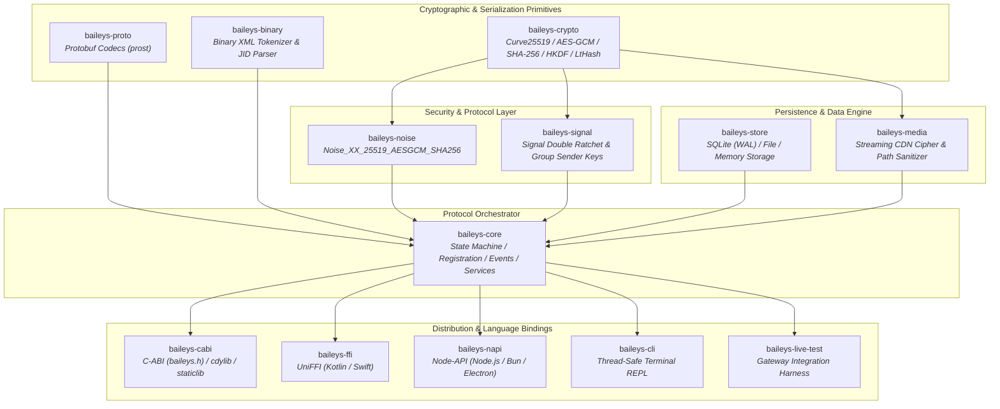

# Rolleys

[](https://github.com/66XZD/Rolleys/actions/workflows/ci.yml)
[](https://github.com/Towartz/Rust-Baileys/actions/workflows/ci.yml)
[](LICENSE)
[](Cargo.toml)

An asynchronous, modular WhatsApp Web Multi-Device protocol engine written in pure Rust.

Rolleys provides protocol parity with WhatsApp Web without requiring a Node.js or browser runtime. It encompasses the complete protocol lifecycle: cryptographic handshakes, Signal end-to-end encryption, binary XML stanza framing, media streaming and deciphering, AppState differential synchronization, and persistent session storage.

---

## Architecture

Rolleys is structured as a collection of decoupled, layered crates designed for standalone reuse or unified deployment across desktop, mobile, embedded, and server runtimes.



---

## Workspace Crates

| Crate | Path | Responsibility | Primary Dependencies |
| :--- | :--- | :--- | :--- |
| **`baileys-crypto`** | `crates/baileys-crypto` | Cryptographic primitives (Curve25519, Ed25519, AES-GCM, AES-CBC, AES-CTR, HKDF, HMAC-SHA256, LtHash) | `x25519-dalek`, `ed25519-dalek`, `aes-gcm`, `sha2`, `subtle`, `zeroize` |
| **`baileys-proto`** | `crates/baileys-proto` | Compiled WhatsApp Protobuf schemas with fallback vendored protoc compiler | `prost`, `prost-types`, `protoc-bin-vendored` |
| **`baileys-binary`** | `crates/baileys-binary` | Token dictionary-based binary XML reader/writer and JID address handling | `bytes`, `thiserror` |
| **`baileys-noise`** | `crates/baileys-noise` | Handshake state machine and frame cipher for `Noise_XX_25519_AESGCM_SHA256` | `baileys-crypto`, `baileys-binary` |
| **`baileys-signal`** | `crates/baileys-signal` | Signal Double Ratchet, Pre-Key bundles, Session Cipher, and Group Sender Keys | `baileys-crypto`, `baileys-proto`, `baileys-store` |
| **`baileys-store`** | `crates/baileys-store` | Session keys, chats, messages, and contact storage via embedded SQLite (`WAL`), multi-file, or memory | `rusqlite` (bundled), `tokio`, `serde`, `serde_json` |
| **`baileys-media`** | `crates/baileys-media` | Streaming WhatsApp CDN upload/download, AES-CBC-256 deciphering, and path sanitization | `reqwest`, `baileys-crypto`, `tokio-util`, `futures-util` |
| **`baileys-core`** | `crates/baileys-core` | Connection lifecycle, retry state machines, event broadcasting, AppState sync, and messaging APIs | `tokio`, `tokio-tungstenite`, `rustls` (dual WebPKI/native roots) |
| **`baileys-cabi`** | `bindings/baileys-cabi` | Universal C-ABI header (`baileys.h`) producing dynamic and static libraries for C, C++, Dart, Python, and Go | `baileys-core`, `baileys-store` |
| **`baileys-ffi`** | `bindings/baileys-ffi` | UniFFI multiplatform bindings generating Kotlin (Android JNI) and Swift (iOS / macOS) | `uniffi`, `baileys-core`, `baileys-store` |
| **`baileys-napi`** | `bindings/baileys-napi` | Node-API bindings for direct integration with Node.js, Bun, and Electron applications | `baileys-core`, `baileys-store` |
| **`baileys-cli`** | `tools/baileys-cli` | Interactive command-line client with QR pairing, phone pairing, and safe background logging | `rustyline`, `baileys-core`, `baileys-store`, `qrcode` |
| **`baileys-live-test`** | `tools/baileys-live-test` | Gateway integration test harness validating session pairing and message roundtrips | `baileys-core`, `baileys-store`, `tokio` |

---

## Target Platforms & Support Matrix

Rolleys is continuously tested against the following targets in CI:

| Platform | Target Triple | Tier | Distribution / Output | ABI Interface |
| :--- | :--- | :---: | :--- | :--- |
| **Windows** | `x86_64-pc-windows-msvc`<br/>`aarch64-pc-windows-msvc` | Tier 1 | Executable, DLL (`baileys_cabi.dll`), StaticLib (`baileys_cabi.lib`) | C-ABI, Native Rust |
| **Linux** | `x86_64-unknown-linux-gnu`<br/>`x86_64-unknown-linux-musl`<br/>`aarch64-unknown-linux-gnu`<br/>`aarch64-unknown-linux-musl` | Tier 1 | Statically linked binary, Shared object (`libbaileys_cabi.so`) | C-ABI, Native Rust |
| **macOS** | `aarch64-apple-darwin`<br/>`x86_64-apple-darwin` | Tier 1 | Universal Mach-O fat binary, DyLib (`libbaileys_cabi.dylib`), Swift Package | C-ABI, UniFFI (Swift) |
| **Android** | `aarch64-linux-android`<br/>`armv7-linux-androideabi`<br/>`x86_64-linux-android` | Tier 1 | Android JNI Shared Library (`libbaileys_ffi.so`, API 24+) | UniFFI (Kotlin/JNI), C-ABI |
| **iOS** | `aarch64-apple-ios`<br/>`aarch64-apple-ios-sim`<br/>`x86_64-apple-ios` | Tier 2 | XCFramework, Static Archive (`libbaileys_ffi.a`) | UniFFI (Swift) |
| **Node.js** | Node.js 18+ / Electron / Bun | Tier 2 | `.node` native binary addon | Node-API (N-API) |

---

## Quickstart

Add `baileys-core` and `baileys-store` to your `Cargo.toml`:

```toml
[dependencies]
baileys-core = { path = "crates/baileys-core" }
baileys-store = { path = "crates/baileys-store" }
tokio = { version = "1.40", features = ["full"] }
```

### Initializing and Connecting a Client

```rust
use std::sync::Arc;
use baileys_core::{BaileysClient, BaileysConfigBuilder, BaileysEvent};
use baileys_store::SqliteStore;

#[tokio::main]
async fn main() -> Result<(), Box<dyn std::error::Error>> {
    // 1. Initialize persistent SQLite session storage (WAL mode)
    let store = Arc::new(SqliteStore::open("session.db")?);

    // 2. Configure client parameters
    let config = BaileysConfigBuilder::new()
        .with_browser("Rolleys", "Linux", "1.0.0")
        .build();

    // 3. Instantiate client and subscribe to the broadcast event receiver
    let client = Arc::new(BaileysClient::new(store, config));
    let mut events = client.events();

    // 4. Handle connection lifecycle and message events
    tokio::spawn(async move {
        while let Ok(event) = events.recv().await {
            match event {
                BaileysEvent::Connecting => {
                    println!("Connecting to WhatsApp Web gateway...");
                }
                BaileysEvent::QrCode { code } => {
                    println!("Scan pairing QR: {code}");
                }
                BaileysEvent::PairingCode { code } => {
                    println!("Pairing code: {code}");
                }
                BaileysEvent::Connected { me_jid } => {
                    println!("Authenticated successfully as: {me_jid}");
                }
                BaileysEvent::Message { message } => {
                    if let Some(msg) = message.message {
                        println!("Message received: {msg:?}");
                    }
                }
                BaileysEvent::Disconnected { reason } => {
                    println!("Disconnected: {reason}");
                }
                _ => {}
            }
        }
    });

    // 5. Connect to the gateway
    client.connect().await?;

    // Block on termination signal
    tokio::signal::ctrl_c().await?;
    Ok(())
}
```

### Sending Messages

```rust
// Send a plaintext message
client.messages().send_text("1234567890@s.whatsapp.net", "Hello from Rust!").await?;

// Send a message quoting an earlier message
client.messages().send_text_with_quote(
    "1234567890@s.whatsapp.net",
    "Replying to your query",
    "MESSAGE_ID_STAMP",
    "Original message content",
    None,
).await?;
```

---

## Language Bindings & Foreign Function Interfaces

### C / C++ / Embedded (`baileys-cabi`)
The Universal C-ABI is exposed through `bindings/c/baileys.h`. Build the dynamic or static library:
```bash
cargo build --release -p baileys-cabi
```
Link against:
- Windows: `target/release/baileys_cabi.dll` / `baileys_cabi.lib`
- Linux / Android: `target/release/libbaileys_cabi.so`
- macOS: `target/release/libbaileys_cabi.dylib`

### Android Kotlin / Swift UniFFI (`baileys-ffi`)
Generate Swift and Kotlin bindings using `uniffi-bindgen`:
```bash
# Android JNI build
./scripts/build-android-jni.sh

# Apple XCFramework build
./scripts/build-apple.sh --ios
```

### Node.js / Electron (`baileys-napi`)
Direct Node-API bridge providing low-overhead asynchronous bindings:
```bash
cd bindings/baileys-napi
npm install
npm run build
```

---

## Building and Verification

### Prerequisites
- Rust stable toolchain 1.75 or later (`rustup update stable`).
- CMake (required only for bundled SQLite compilation on certain cross targets).
- Optional: `protoc` installed locally (if absent, `baileys-proto` falls back automatically to `protoc-bin-vendored`).

### Build Workspace
```bash
cargo build --workspace
```

### Run Unit and Integration Tests
```bash
cargo test --workspace --lib
```

### Formatting and Lint Compliance
```bash
cargo fmt --all --check
cargo clippy --workspace --all-targets -D warnings
```

### Cross-Compilation

#### Android (NDK & cargo-ndk)
```powershell
# Using repository cross-compilation automation
.\scripts\build-cli-cross.ps1 -Target aarch64-linux-android -Release
```

#### Linux MUSL (Zero-dependency static binary)
```bash
cargo build --release --target x86_64-unknown-linux-musl -p baileys-cli
```

---

## Technical Specifications & Concurrency Model

- **Memory Safety & Zeroization**: Cryptographic keys (`AuthCreds`, `KeyPair`, `AdvSecretKey`) implement automatic zeroization on drop via `zeroize`. All secret-dependent conditional operations use `subtle` constant-time comparisons.
- **Embedded WebPKI Fallback**: `tokio-tungstenite` is configured with `rustls-tls-webpki-roots` in addition to `rustls-tls-native-roots`. This guarantees reliable TLS handshakes in minimal Docker scratch containers and Android sandboxes lacking system root certificates.
- **SQLite Concurrency**: `SqliteStore` operates under `PRAGMA journal_mode = WAL` and `PRAGMA synchronous = NORMAL`. This design permits concurrent readers without locking the writer, preventing contention on mobile flash storage.
- **Filename Sanitization**: `baileys-media` implements cross-platform path validation, stripping directory traversal tokens and guarding against Windows reserved device names (`CON`, `PRN`, `AUX`, `NUL`, `COM1-9`, `LPT1-9`).

---

## License

Licensed under either of:

- Apache License, Version 2.0 ([LICENSE-APACHE](LICENSE-APACHE) or https://www.apache.org/licenses/LICENSE-2.0)
- MIT License ([LICENSE-MIT](LICENSE-MIT) or https://opensource.org/licenses/MIT)

at your option.

---

## Disclaimer

Rolleys is an independent open-source protocol implementation developed for research, interoperability, and systems engineering purposes. It is not affiliated with, authorized, maintained, sponsored, or endorsed by Meta Platforms, Inc., WhatsApp LLC, or any of their affiliates. WhatsApp is a registered trademark of WhatsApp LLC.
