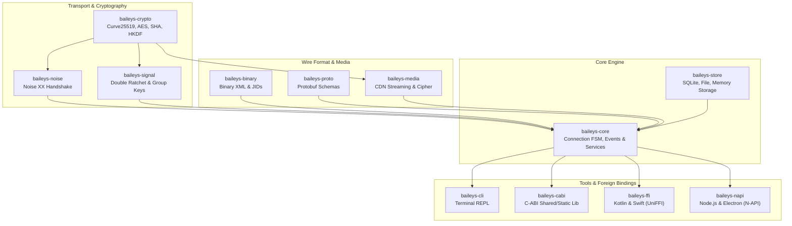

# Rolleys

[](https://github.com/Towartz/Rolleys/actions/workflows/ci.yml)
[](https://github.com/66XZD/Rolleys/actions/workflows/ci.yml)
[](LICENSE)
[](https://github.com/Towartz)
[](Cargo.toml)
[](docs/)

A modular WhatsApp Web multi-device client library for Rust.

Rolleys connects directly to the WhatsApp Web multi-device WebSocket gateway without running a browser instance, headless Chromium, or Node.js. Built on Tokio, it implements the full connection lifecycle: Noise protocol handshakes, Signal Double Ratchet encryption, binary XML framing, media uploads and downloads, and local session persistence.

Maintained by [Towartz](https://github.com/Towartz) and contributors.

---

## Overview

- **Direct Gateway Connection**: Speaks the WhatsApp Web WebSocket protocol directly over TLS and Noise XX.
- **End-to-End Encryption**: Signal Double Ratchet for 1:1 chats and Sender Keys for group messages.
- **Media Support**: Encrypted streaming upload and download via the WhatsApp CDN with automatic deciphering.
- **Persistent Storage**: Out-of-the-box session management backed by SQLite (WAL mode), JSON files, or memory.
- **Multi-Language Bindings**: C-ABI libraries, Swift packages, Android Kotlin (JNI), and Node.js addons.
- **Interactive CLI**: Terminal REPL with on-screen QR rendering, phone code pairing, and live debugging commands.

---

## Architecture

Rolleys is structured into layered crates so you can use the complete engine or depend only on the primitives you need.



---

## Workspace Crates

| Crate | Path | Responsibility | Key Dependencies |
| :--- | :--- | :--- | :--- |
| `baileys-core` | `crates/baileys-core` | Connection lifecycle, event dispatch, and messaging services | `tokio`, `tokio-tungstenite`, `rustls` |
| `baileys-store` | `crates/baileys-store` | Session keys, chats, and messages in SQLite, JSON files, or memory | `rusqlite`, `serde_json` |
| `baileys-crypto` | `crates/baileys-crypto` | Cryptographic primitives (Curve25519, AES-GCM, SHA-256, HKDF, LtHash) | `x25519-dalek`, `ed25519-dalek`, `aes-gcm` |
| `baileys-noise` | `crates/baileys-noise` | Handshake state machine and frame cipher for Noise XX | `baileys-crypto`, `baileys-binary` |
| `baileys-signal` | `crates/baileys-signal` | Signal Double Ratchet, pre-keys, and group sender keys | `baileys-crypto`, `baileys-proto`, `baileys-store` |
| `baileys-binary` | `crates/baileys-binary` | Token-based binary XML reader/writer and JID handling | `bytes`, `thiserror` |
| `baileys-proto` | `crates/baileys-proto` | Compiled WhatsApp Protobuf schemas | `prost`, `protoc-bin-vendored` |
| `baileys-media` | `crates/baileys-media` | WhatsApp CDN uploads, downloads, deciphering, and path checks | `reqwest`, `baileys-crypto` |
| `baileys-cabi` | `bindings/baileys-cabi` | Universal C-ABI header and shared/static libraries | `baileys-core`, `baileys-store` |
| `baileys-ffi` | `bindings/baileys-ffi` | UniFFI multiplatform bindings for Kotlin and Swift | `uniffi`, `baileys-core` |
| `baileys-napi` | `bindings/baileys-napi` | Native Node-API bindings for Node.js, Bun, and Electron | `baileys-core`, `baileys-store` |
| `baileys-cli` | `tools/baileys-cli` | Interactive terminal client with QR pairing and background logging | `rustyline`, `qrcode`, `baileys-core` |
| `baileys-live-test` | `tools/baileys-live-test` | Gateway integration harness for auth and message roundtrips | `baileys-core`, `baileys-store` |

---

## Quickstart

Add `baileys-core`, `baileys-store`, and `tokio` to your `Cargo.toml`:

```toml
[dependencies]
baileys-core = { path = "crates/baileys-core" }
baileys-store = { path = "crates/baileys-store" }
tokio = { version = "1.40", features = ["full"] }
```

### Connect and Listen to Events

The following example initializes an embedded SQLite session store, connects to the gateway, and logs incoming events:

```rust
use std::sync::Arc;
use baileys_core::{BaileysClient, BaileysConfigBuilder, BaileysEvent};
use baileys_store::SqliteStore;

#[tokio::main]
async fn main() -> Result<(), Box<dyn std::error::Error>> {
    // 1. Open persistent SQLite storage for credentials and state
    let store = Arc::new(SqliteStore::open("session.db")?);

    // 2. Configure client properties
    let config = BaileysConfigBuilder::new()
        .with_browser("Rolleys", "Linux", "1.0.0")
        .build();

    let client = Arc::new(BaileysClient::new(store, config));
    let mut events = client.events();

    // 3. Process events on a background task
    tokio::spawn(async move {
        while let Ok(event) = events.recv().await {
            match event {
                BaileysEvent::Connecting => println!("Connecting to gateway..."),
                BaileysEvent::QrCode { code } => println!("Scan this pairing QR: {code}"),
                BaileysEvent::PairingCode { code } => println!("Pairing code: {code}"),
                BaileysEvent::Connected { me_jid } => println!("Connected as {me_jid}"),
                BaileysEvent::Message { message } => {
                    println!("Received message from: {:?}", message.key.remote_jid);
                }
                BaileysEvent::Disconnected { reason } => println!("Disconnected: {reason}"),
                _ => {}
            }
        }
    });

    // 4. Initiate the connection
    client.connect().await?;

    tokio::signal::ctrl_c().await?;
    Ok(())
}
```

### Common Actions

#### Sending Messages

```rust
// Plaintext message
client.messages().send_text("62812345678@s.whatsapp.net", "Hello from Rolleys!").await?;

// Quoted reply
client.messages().send_text_with_quote(
    "62812345678@s.whatsapp.net",
    "Replying to your query",
    "TARGET_MESSAGE_ID",
    "Original message preview",
    None,
).await?;
```

#### Media and Reactions

```rust
// Encrypted photo
let image_bytes = std::fs::read("photo.jpg")?;
client.messages().send_image("62812345678@s.whatsapp.net", &image_bytes, Some("Photo caption")).await?;

// Emoji reaction
client.messages().send_reaction("62812345678@s.whatsapp.net", "TARGET_MESSAGE_ID", "🚀").await?;
```

#### Groups and Newsletters

```rust
// Create a group
let group_jid = client.groups().create_group(
    "Rust Developers",
    vec!["6281111111@s.whatsapp.net".into(), "6282222222@s.whatsapp.net".into()],
).await?;

// Create a newsletter channel
let channel = client.newsletters().create("Rolleys Updates", Some("Release announcements"), None).await?;
client.newsletters().send_text(&channel.jid, "Version 0.1.0 released!").await?;
```

---

## Interactive Terminal CLI (`baileys-cli`)

Rolleys includes an interactive terminal REPL for testing connections, pairing devices, and inspecting protocol messages:

```bash
cargo run -p baileys-cli
```

Common commands in the REPL:

- `qr`: Print the latest pairing QR code in the terminal.
- `send <jid> <text>`: Send a text message.
- `sendimage <jid> <path> [caption]`: Upload and send an encrypted image.
- `status`: Print connection health, latency, and telemetry counts.
- `ghost [on|off]`: Toggle suppression of read receipts and story views.
- `bot [off|self|public]`: Toggle the built-in automated command handler.

Detailed flags, automated scripts, and REPL workflows are documented in the [CLI Manual](docs/CLI_MANUAL.md).

---

## Foreign Function Interfaces (FFI)

You can embed Rolleys into non-Rust applications using pre-built bindings:

### C / C++ / Embedded
Use the C header at [`bindings/c/baileys.h`](bindings/c/baileys.h) and build shared or static libraries:
```bash
cargo build --release -p baileys-cabi
```
Outputs `baileys_cabi.dll` (Windows), `libbaileys_cabi.so` (Linux/Android), or `libbaileys_cabi.dylib` (macOS).

### Android (Kotlin / JNI)
Generate Kotlin classes and compile native JNI libraries for Android:
```bash
./scripts/build-android-jni.sh
```

### Apple Platforms (Swift / iOS / macOS)
Compile Swift packages and static XCFramework archives:
```bash
./scripts/build-apple.sh --ios
```

### Node.js & Electron
Install and compile the native addon with Node-API:
```bash
cd bindings/baileys-napi
npm install
npm run build
```

Full usage examples for each language are available in the [FFI Integration Guide](docs/FFI_GUIDE.md).

---

## Target Platforms

Rolleys is built and tested against the following targets in CI:

| Platform | Target Triple | Support Level | Output Formats |
| :--- | :--- | :---: | :--- |
| Windows | `x86_64-pc-windows-msvc`<br/>`aarch64-pc-windows-msvc` | Tier 1 | Executable, DLL (`baileys_cabi.dll`), StaticLib (`baileys_cabi.lib`) |
| Linux | `x86_64-unknown-linux-gnu`<br/>`x86_64-unknown-linux-musl`<br/>`aarch64-unknown-linux-gnu`<br/>`aarch64-unknown-linux-musl` | Tier 1 | Static binary, Shared object (`libbaileys_cabi.so`) |
| macOS | `aarch64-apple-darwin`<br/>`x86_64-apple-darwin` | Tier 1 | Universal binary, DyLib (`libbaileys_cabi.dylib`), Swift Package |
| Android | `aarch64-linux-android`<br/>`armv7-linux-androideabi`<br/>`x86_64-linux-android` | Tier 1 | Android JNI Shared Library (`libbaileys_ffi.so`, API 24+) |
| iOS | `aarch64-apple-ios`<br/>`aarch64-apple-ios-sim`<br/>`x86_64-apple-ios` | Tier 2 | XCFramework, Static Archive (`libbaileys_ffi.a`) |
| Node.js | Node.js 18+, Bun, Electron | Tier 2 | `.node` native binary addon |

---

## Building from Source

### Workspace Builds and Tests

```bash
# Build all workspace crates
cargo build --workspace

# Run unit and integration tests
cargo test --workspace --lib

# Check formatting and clippy lints
cargo fmt --all --check
cargo clippy --workspace --all-targets -D warnings
```

### Cross-Compilation Examples

Android NDK cross-build:
```powershell
.\scripts\build-cli-cross.ps1 -Target aarch64-linux-android -Release
```

Statically linked Linux binary with MUSL:
```bash
cargo build --release --target x86_64-unknown-linux-musl -p baileys-cli
```

---

## Security & Storage Details

- **Cryptographic Zeroization**: Private keys and secrets (`AuthCreds`, `KeyPair`, `AdvSecretKey`) implement `zeroize::ZeroizeOnDrop` to clear memory when discarded. Constant-time checks are enforced through `subtle::ConstantTimeEq`.
- **Embedded WebPKI Roots**: `tokio-tungstenite` embeds `rustls-tls-webpki-roots` alongside system certificates, ensuring TLS verification succeeds in minimal containers and Android sandboxes.
- **SQLite Concurrency**: `SqliteStore` runs with `PRAGMA journal_mode = WAL` and `PRAGMA synchronous = NORMAL`, allowing concurrent reads during socket write operations.
- **Path Sanitization**: `baileys-media` protects against path traversal sequences and Windows reserved device names (`CON`, `PRN`, `AUX`, `NUL`, `COM1-9`, `LPT1-9`) when writing media to disk.

---

## Documentation

Full reference documentation is located in the [`docs/`](docs/) directory:

- [Architecture & Protocol Lifecycle](docs/ARCHITECTURE.md): Noise XX handshakes, Double Ratchet, binary XML, and AppState synchronization.
- [API Reference Guide](docs/API_REFERENCE.md): Method signatures, domain services (`messages`, `groups`, `newsletters`, `status`, `privacy`), and event schemas.
- [CLI Manual & REPL Guide](docs/CLI_MANUAL.md): Command reference, pairing modes, and headless test runners.
- [FFI Integration Guide](docs/FFI_GUIDE.md): Code examples for C, Kotlin, Swift, and Node.js.

---

## Authors & License

Maintained by [Towartz](https://github.com/Towartz) and open-source contributors.

Rolleys is dual-licensed under either:

- Apache License, Version 2.0 ([LICENSE-APACHE](LICENSE-APACHE) or https://www.apache.org/licenses/LICENSE-2.0)
- MIT License ([LICENSE-MIT](LICENSE-MIT) or https://opensource.org/licenses/MIT)

at your option. See [LICENSE](LICENSE) for details.

---

## Disclaimer

Rolleys is an independent open-source protocol implementation developed for research, interoperability, and systems engineering. It is not affiliated with, authorized, maintained, sponsored, or endorsed by Meta Platforms, Inc., WhatsApp LLC, or any of their affiliates. WhatsApp is a registered trademark of WhatsApp LLC.
