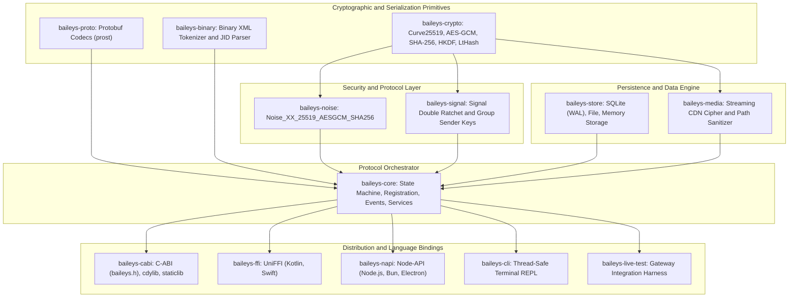

# Rolleys

[](https://github.com/Towartz/Rolleys/actions/workflows/ci.yml)
[](https://github.com/66XZD/Rolleys/actions/workflows/ci.yml)
[](LICENSE)
[](https://github.com/Towartz)
[](Cargo.toml)
[](docs/)

An asynchronous, modular WhatsApp Web Multi-Device protocol engine written in pure Rust.

Rolleys provides complete protocol parity with WhatsApp Web without requiring a browser instance, headless Chromium, or Node.js runtime. Built from first principles on `tokio`, Rolleys handles the entire protocol lifecycle: cryptographic handshakes, Signal end-to-end encryption, binary XML stanza framing, media streaming and deciphering, AppState differential synchronization, and persistent storage.

Maintained by **[Towartz](https://github.com/Towartz)** and contributors.

---

## Table of Contents
- [Architecture](#architecture)
- [Documentation Index](#documentation-index)
- [Workspace Crates](#workspace-crates)
- [Target Platforms & Support Matrix](#target-platforms--support-matrix)
- [Quickstart Guide](#quickstart-guide)
  - [Session Storage Setup](#1-session-storage-setup)
  - [Client Initialization & Connection](#2-client-initialization--connection)
  - [Sending Messages & Quotes](#3-sending-messages--quotes)
  - [Media, Documents & Reactions](#4-media-documents--reactions)
  - [Group Administration](#5-group-administration)
  - [Newsletters & Channels](#6-newsletters--channels)
- [Interactive Terminal REPL (baileys-cli)](#interactive-terminal-repl-baileys-cli)
- [Foreign Function Interfaces (FFI)](#foreign-function-interfaces-ffi)
  - [C-ABI (C / C++ / Embedded)](#c-abi-c--c--embedded)
  - [Android JNI & Kotlin](#android-jni--kotlin)
  - [Apple Swift & iOS](#apple-swift--ios)
  - [Node.js & Electron](#nodejs--electron)
- [Building & Cross-Compilation](#building--cross-compilation)
- [Technical Specifications & Security Guarantees](#technical-specifications--security-guarantees)
- [Authors & License](#authors--license)
- [Disclaimer](#disclaimer)

---

## Architecture

Rolleys is decomposed into independent, modular crates designed for standalone use or unified cross-platform deployment.



---

## Documentation Index

Detailed engineering manuals and reference guides are maintained in the [`docs/`](docs/) directory:

- [**Architecture & Protocol Lifecycle**](docs/ARCHITECTURE.md): Noise XX handshakes, Signal Double Ratchet, Binary XML compression, AppState Merkle sync.
- [**API Reference Guide**](docs/API_REFERENCE.md): Full method signatures, events, error types, domain services (`messages`, `groups`, `newsletters`, `status`, `privacy`).
- [**CLI Manual & REPL Guide**](docs/CLI_MANUAL.md): Interactive command reference, pairing workflows (QR, Phone code), In-Chat Bot runner.
- [**FFI & Multiplatform Embedding**](docs/FFI_GUIDE.md): C-ABI integration, Android JNI / Kotlin, Apple Swift / iOS XCFramework, Node.js N-API.

---

## Workspace Crates

| Crate | Path | Responsibility | Primary Dependencies |
| :--- | :--- | :--- | :--- |
| **`baileys-crypto`** | `crates/baileys-crypto` | Cryptographic primitives (Curve25519, Ed25519, AES-GCM, AES-CBC, AES-CTR, HKDF, HMAC-SHA256, LtHash) | `x25519-dalek`, `ed25519-dalek`, `aes-gcm`, `sha2`, `subtle`, `zeroize` |
| **`baileys-proto`** | `crates/baileys-proto` | Compiled WhatsApp Protobuf schemas with fallback vendored protoc compiler | `prost`, `prost-types`, `protoc-bin-vendored` |
| **`baileys-binary`** | `crates/baileys-binary` | Token dictionary-based binary XML reader/writer and JID address handling | `bytes`, `thiserror` |
| **`baileys-noise`** | `crates/baileys-noise` | Handshake state machine and frame cipher for `Noise_XX_25519_AESGCM_SHA256` | `baileys-crypto`, `baileys-binary` |
| **`baileys-signal`** | `crates/baileys-signal` | Signal Double Ratchet, Pre-Key bundles, Session Cipher, and Group Sender Keys | `baileys-crypto`, `baileys-proto`, `baileys-store` |
| **`baileys-store`** | `crates/baileys-store` | Session keys, chats, messages, and contact storage via embedded SQLite (`WAL`), multi-file, or memory | `rusqlite` (bundled), `tokio`, `serde`, `serde_json` |
| **`baileys-media`** | `crates/baileys-media` | Streaming WhatsApp CDN upload/download, AES-CBC-256 deciphering, and path sanitization | `reqwest`, `baileys-crypto`, `tokio-util`, `futures-util` |
| **`baileys-core`** | `crates/baileys-core` | Connection lifecycle, retry state machines, event broadcasting, AppState sync, and messaging APIs | `tokio`, `tokio-tungstenite`, `rustls` (dual WebPKI/native roots) |
| **`baileys-cabi`** | `bindings/baileys-cabi` | Universal C-ABI header (`baileys.h`) producing dynamic and static libraries for C, C++, Dart, Python, and Go | `baileys-core`, `baileys-store` |
| **`baileys-ffi`** | `bindings/baileys-ffi` | UniFFI multiplatform bindings generating Kotlin (Android JNI) and Swift (iOS / macOS) | `uniffi`, `baileys-core`, `baileys-store` |
| **`baileys-napi`** | `bindings/baileys-napi` | Node-API bindings for direct integration with Node.js, Bun, and Electron applications | `baileys-core`, `baileys-store` |
| **`baileys-cli`** | `tools/baileys-cli` | Interactive command-line client with QR pairing, phone pairing, and safe background logging | `rustyline`, `baileys-core`, `baileys-store`, `qrcode` |
| **`baileys-live-test`** | `tools/baileys-live-test` | Gateway integration test harness validating session pairing and message roundtrips | `baileys-core`, `baileys-store`, `tokio` |

---

## Target Platforms & Support Matrix

Rolleys is continuously built and tested against the following targets in CI:

| Platform | Target Triple | Tier | Distribution / Output | ABI Interface |
| :--- | :--- | :---: | :--- | :--- |
| **Windows** | `x86_64-pc-windows-msvc`<br/>`aarch64-pc-windows-msvc` | Tier 1 | Executable, DLL (`baileys_cabi.dll`), StaticLib (`baileys_cabi.lib`) | C-ABI, Native Rust |
| **Linux** | `x86_64-unknown-linux-gnu`<br/>`x86_64-unknown-linux-musl`<br/>`aarch64-unknown-linux-gnu`<br/>`aarch64-unknown-linux-musl` | Tier 1 | Statically linked binary, Shared object (`libbaileys_cabi.so`) | C-ABI, Native Rust |
| **macOS** | `aarch64-apple-darwin`<br/>`x86_64-apple-darwin` | Tier 1 | Universal Mach-O fat binary, DyLib (`libbaileys_cabi.dylib`), Swift Package | C-ABI, UniFFI (Swift) |
| **Android** | `aarch64-linux-android`<br/>`armv7-linux-androideabi`<br/>`x86_64-linux-android` | Tier 1 | Android JNI Shared Library (`libbaileys_ffi.so`, API 24+) | UniFFI (Kotlin/JNI), C-ABI |
| **iOS** | `aarch64-apple-ios`<br/>`aarch64-apple-ios-sim`<br/>`x86_64-apple-ios` | Tier 2 | XCFramework, Static Archive (`libbaileys_ffi.a`) | UniFFI (Swift) |
| **Node.js** | Node.js 18+ / Electron / Bun | Tier 2 | `.node` native binary addon | Node-API (N-API) |

---

## Quickstart Guide

Add `baileys-core` and `baileys-store` to your `Cargo.toml`:

```toml
[dependencies]
baileys-core = { path = "crates/baileys-core" }
baileys-store = { path = "crates/baileys-store" }
tokio = { version = "1.40", features = ["full"] }
```

### 1. Session Storage Setup
Rolleys provides out-of-the-box persistent storage via embedded SQLite:
```rust
use baileys_store::SqliteStore;
use std::sync::Arc;

let store = Arc::new(SqliteStore::open("session.db")?);
```

### 2. Client Initialization & Connection
```rust
use baileys_core::{BaileysClient, BaileysConfigBuilder, BaileysEvent};

#[tokio::main]
async fn main() -> Result<(), Box<dyn std::error::Error>> {
    let store = Arc::new(SqliteStore::open("session.db")?);
    let config = BaileysConfigBuilder::new()
        .with_browser("Rolleys", "Linux", "1.0.0")
        .build();

    let client = Arc::new(BaileysClient::new(store, config));
    let mut events = client.events();

    tokio::spawn(async move {
        while let Ok(event) = events.recv().await {
            match event {
                BaileysEvent::Connecting => println!("Connecting to gateway..."),
                BaileysEvent::QrCode { code } => println!("Pairing QR: {code}"),
                BaileysEvent::Connected { me_jid } => println!("Connected as {me_jid}"),
                BaileysEvent::Message { message } => {
                    println!("Received message from: {:?}", message.key.remote_jid);
                }
                BaileysEvent::Disconnected { reason } => println!("Disconnected: {reason}"),
                _ => {}
            }
        }
    });

    client.connect().await?;
    tokio::signal::ctrl_c().await?;
    Ok(())
}
```

### 3. Sending Messages & Quotes
```rust
// Plaintext message
client.messages().send_text("62812345678@s.whatsapp.net", "Hello from Rolleys!").await?;

// Quoted reply
client.messages().send_text_with_quote(
    "62812345678@s.whatsapp.net",
    "Replying to your query",
    "TARGET_MESSAGE_ID",
    "Original message preview",
    None,
).await?;
```

### 4. Media, Documents & Reactions
```rust
// Encrypted photo
let image_bytes = std::fs::read("photo.jpg")?;
client.messages().send_image("62812345678@s.whatsapp.net", &image_bytes, Some("Photo caption")).await?;

// Emoji reaction
client.messages().send_reaction("62812345678@s.whatsapp.net", "TARGET_MESSAGE_ID", "🚀").await?;
```

### 5. Group Administration
```rust
// Create group
let group_jid = client.groups().create_group(
    "Rust Engineers",
    vec!["6281111111@s.whatsapp.net".into(), "6282222222@s.whatsapp.net".into()],
).await?;

// Add participant
client.groups().add_participants(&group_jid, vec!["6283333333@s.whatsapp.net".into()]).await?;
```

### 6. Newsletters & Channels
```rust
// Create a channel
let channel = client.newsletters().create("Rolleys News", Some("Public announcements"), None).await?;

// Post an announcement
client.newsletters().send_text(&channel.jid, "Version 0.1.0 released!").await?;
```

---

## Interactive Terminal REPL (`baileys-cli`)

Rolleys includes a full-featured terminal CLI with safe, asynchronous logging and on-demand QR rendering:

```bash
cargo run -p baileys-cli
```

### Key Commands
- `qr`: Displays clean half-block unicode QR pairing code.
- `send <jid> <text>`: Transmits a plaintext message.
- `sendimage <jid> <path> [caption]`: Uploads and sends encrypted media.
- `status`: Displays engine health, latency, and telemetry counters.
- `ghost [on|off]`: Suppresses read receipts and status views.
- `bot [off|self|public]`: Toggles embedded in-chat automated command handler.

For complete CLI documentation, refer to [**CLI Manual**](docs/CLI_MANUAL.md).

---

## Foreign Function Interfaces (FFI)

### C-ABI (C / C++ / Embedded)
The Universal C-ABI header is located at [`bindings/c/baileys.h`](bindings/c/baileys.h):
```bash
cargo build --release -p baileys-cabi
```
Link against `baileys_cabi.dll` (Windows), `libbaileys_cabi.so` (Linux/Android), or `libbaileys_cabi.dylib` (macOS).

### Android JNI & Kotlin
Generate Kotlin bindings and compile native JNI shared libraries:
```bash
./scripts/build-android-jni.sh
```

### Apple Swift & iOS
Generate Swift packages and XCFramework static archives:
```bash
./scripts/build-apple.sh --ios
```

### Node.js & Electron
Direct native addon via Node-API:
```bash
cd bindings/baileys-napi
npm install
npm run build
```

See [**FFI Integration Guide**](docs/FFI_GUIDE.md) for full code examples across each language.

---

## Building & Cross-Compilation

### Local Development
```bash
# Build workspace
cargo build --workspace

# Run full test suite
cargo test --workspace --lib

# Linter and formatting check
cargo fmt --all --check
cargo clippy --workspace --all-targets -D warnings
```

### Android NDK Cross-Compilation
```powershell
.\scripts\build-cli-cross.ps1 -Target aarch64-linux-android -Release
```

### Linux MUSL Static Binary
```bash
cargo build --release --target x86_64-unknown-linux-musl -p baileys-cli
```

---

## Technical Specifications & Security Guarantees

- **Memory Hygiene & Zeroization**: Cryptographic keys (`AuthCreds`, `KeyPair`, `AdvSecretKey`) implement automatic zeroization on drop via `zeroize`. Constant-time equality checks are enforced via `subtle::ConstantTimeEq`.
- **Embedded WebPKI Fallback**: `tokio-tungstenite` embeds `rustls-tls-webpki-roots` alongside system root certificates, ensuring dependable TLS termination in minimal container and Android sandbox runtimes.
- **SQLite Concurrency**: `SqliteStore` operates under `PRAGMA journal_mode = WAL` and `PRAGMA synchronous = NORMAL`, allowing concurrent non-blocking reads during active background socket operations.
- **Path Sanitization**: `baileys-media` protects against directory traversal vulnerabilities and Windows reserved device names (`CON`, `PRN`, `AUX`, `NUL`, `COM1-9`, `LPT1-9`).

---

## Authors & License

### Main Author
- **[Towartz](https://github.com/Towartz)** (Primary Maintainer & Copyright Holder)

### Contributors
- Rolleys Open Source Contributors

### Dual License
Rolleys is dual-licensed under either:

- **Apache License, Version 2.0** ([LICENSE-APACHE](LICENSE-APACHE) or https://www.apache.org/licenses/LICENSE-2.0)
- **MIT License** ([LICENSE-MIT](LICENSE-MIT) or https://opensource.org/licenses/MIT)

at your option. See [LICENSE](LICENSE) for details.

---

## Disclaimer

Rolleys is an independent open-source protocol implementation developed for research, interoperability, and systems engineering purposes. It is not affiliated with, authorized, maintained, sponsored, or endorsed by Meta Platforms, Inc., WhatsApp LLC, or any of their affiliates. WhatsApp is a registered trademark of WhatsApp LLC.
