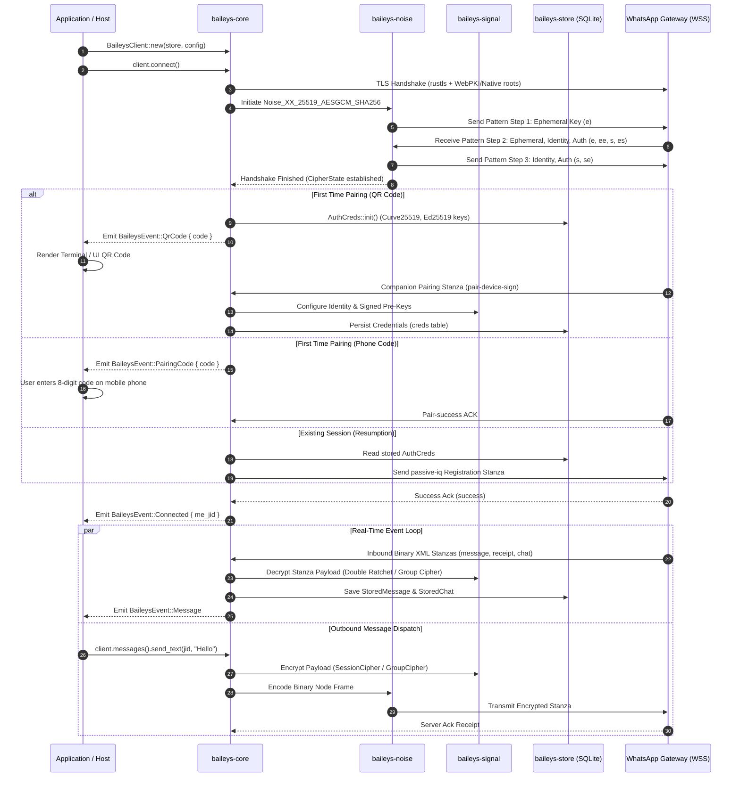

# Rolleys Architectural Specification

This document details the systems design, cryptographic state machines, and protocol implementation of **Rolleys**, a pure Rust asynchronous implementation of the WhatsApp Web Multi-Device protocol.

---

## 1. Protocol Architecture & Lifecycle



---

## 2. Cryptographic Security Engine

### Noise Protocol (`Noise_XX_25519_AESGCM_SHA256`)
WhatsApp Web uses an interactive 3-step Noise XX pattern over WebSocket TLS:
1. **Initiator Hello (`-> e`)**:
   - Generates an ephemeral Curve25519 keypair.
   - Transmits the ephemeral public key to the server.
2. **Responder Reply (`<- e, ee, s, es`)**:
   - Server returns its ephemeral public key, an encrypted static identity key, and an authentication payload.
   - Computes Diffie-Hellman operations: `ee = DH(e_local, e_remote)` and `es = DH(e_local, s_remote)`.
3. **Initiator Finish (`-> s, se`)**:
   - Computes `se = DH(s_local, e_remote)`.
   - Transmits client static identity key and client authentication payload encrypted under the resulting cipher state.
4. **Transport Mode Split**:
   - Derives bidirectional AES-GCM-256 session keys (`enc_key`, `dec_key`) with sequential 64-bit frame counters.

### Signal Protocol Implementation (`baileys-signal`)
- **Key Hierarchy**:
  - **Identity Keypair**: Ed25519 / Curve25519 dual-purpose identity key.
  - **Signed Pre-Key**: Ephemeral Curve25519 key rotated periodically, cryptographically signed by the identity key.
  - **One-Time Pre-Keys**: Pool of Curve25519 keys uploaded in batches of 100 to the WhatsApp key directory.
- **Double Ratchet**:
  - Combines Diffie-Hellman ratchet (forward secrecy) and symmetric key derivation ratchet (break-in recovery).
  - Every message advances the sending/receiving chain key via HMAC-SHA256.
- **Sender Keys (Group E2EE)**:
  - For group chats (`jid@g.us`), Rolleys implements the Signal Group Cipher.
  - Generates a local 32-byte Sender Key and root chain, distributing it to group participants via 1:1 pairwise encrypted `senderKeyDistributionMessage` envelopes. Subsequent group messages require only symmetric derivation, minimizing CPU and network overhead.

### Cryptographic Memory Hygiene
All private keys and symmetric secrets implement Rust's `zeroize::ZeroizeOnDrop`. Secrets are overwritten with zeros immediately upon leaving scope, preventing secret extraction from swapped memory or heap dumps. Constant-time comparisons (`subtle::ConstantTimeEq`) are enforced across all signature and MAC checks.

---

## 3. Wire Framing & Binary XML (`baileys-binary`)

WhatsApp stanzas are serialized as compressed Binary XML trees rather than JSON or raw Protobuf.

### Binary Node Structure
```rust
pub struct BinaryNode {
    pub tag: String,
    pub attrs: HashMap<String, String>,
    pub content: Option<BinaryNodeContent>,
}

pub enum BinaryNodeContent {
    Bytes(Vec<u8>),
    String(String),
    List(Vec<BinaryNode>),
}
```

### Token Compression
- **Single-Byte Tokens**: Bytes `0x01` through `0xEF` map to static protocol strings (e.g., `0x01 = "xmlstreamstart"`, `0x02 = "type"`, `0x03 = "iq"`).
- **Double-Byte Tokens**: Bytes `0xF0` through `0xF3` select token dictionary pages, followed by a secondary byte indexing specialized terms (e.g., `status`, `broadcast`, `newsletter`).
- **JID Encoding**: Custom compact byte packing for JID domains (`@s.whatsapp.net`, `@g.us`, `@lid`, `@newsletter`).

---

## 4. AppState Synchronization (`Syncd`)

WhatsApp synchronizes metadata mutations (contacts, chat pins, archive states, star flags, unread counts) across companion devices using an encrypted Merkle-tree state collection:
1. **Mutation Collections**: `critical_block`, `critical_unblock_low`, `regular`, `regular_high`, `regular_low`.
2. **Patch Derivation**:
   - Each mutation is encrypted using AES-CBC-256 with an AppState sync key derived from root credentials.
   - An index MAC is computed to prevent mutation replay.
   - Mutated states calculate rolling snapshot hashes that ensure bit-exact synchronization with Meta servers.

---

## 5. Persistence Engine & Concurrency (`baileys-store`)

Rolleys uses embedded SQLite as its primary persistence engine:
- **Write-Ahead Logging (WAL)**: `PRAGMA journal_mode = WAL;` enables non-blocking concurrent reads during active socket writes.
- **Synchronous Pragma**: `PRAGMA synchronous = NORMAL;` delivers maximum I/O performance on mobile flash media (Android eMMC/UFS) and desktop SSDs without risking database corruption.
- **Automatic Migration**: Schemas migrate dynamically upon initialization, preserving existing user session databases without requiring external migration binaries.
